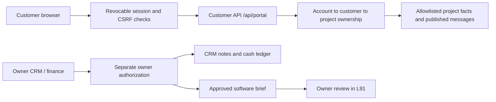
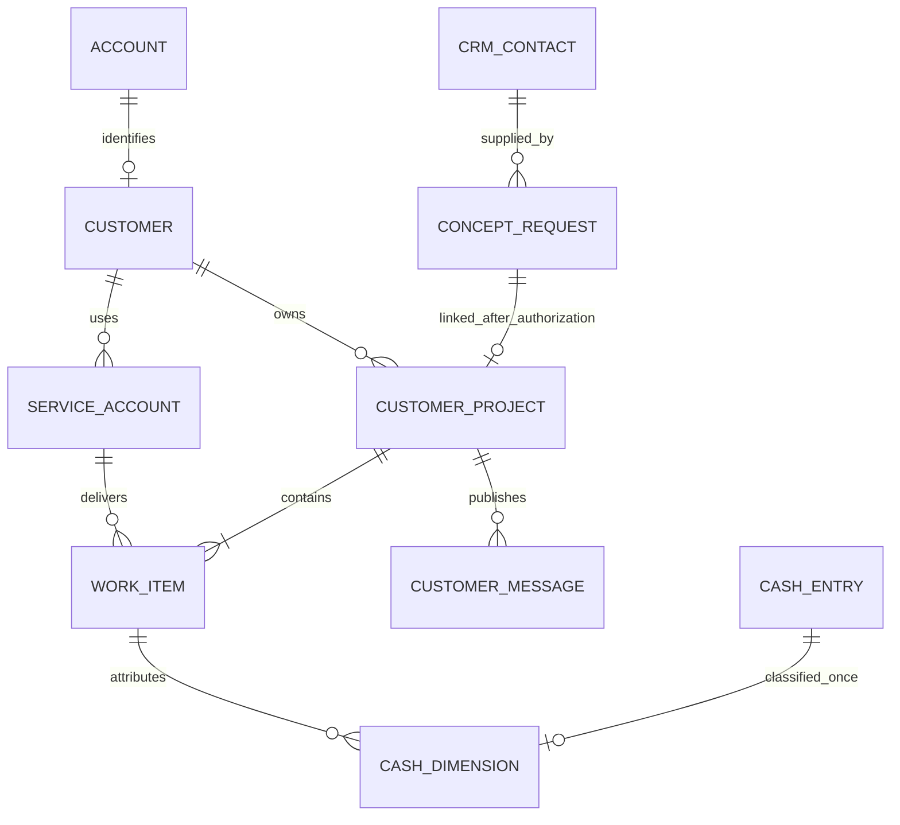

# LupuSpec customer workspace — v0.20.0 candidate

Extends PR #49 (v0.19.0). Source candidate, not an observed production deployment.
The existing Render application serves `/lupuspec`; the Cloudflare L91 factory
remains a separate owner workspace. Existing LandWolf accounts, subscriptions,
customer data and payment integrations are retained.

## Customer experience

- Guest requests retain the v0.19 intake flow and a receipt reference.
- Customers create a LupuSpec account or sign in with their existing LandWolf
  account. Both use the application's existing Argon2/HttpOnly session system.
  Clerk is used by the separate L91 factory; this change does not migrate auth.
- Signed-in submissions can include Studio, Software, Fabrication and Supply in
  one project. Each selected service gets its own work item and status.
- MY PROJECTS lists only the signed-in customer's submissions. Requirements,
  reference links, service status and customer/team messages persist on reload.
- An owner can publish a customer update from CRM, change individual work status,
  and explicitly link a guest request after checking the customer's identity.
- Only an approved Software work item can produce a factory brief. It contains
  the submitted title/requirements and project/work IDs. The owner reviews it and
  copies it into L91. Preparing the brief does not execute code, transmit a task,
  expose runner credentials, purchase parts, or charge a customer.

Customer messages are customer-visible operational records, not internal CRM notes.
The latest 100 are shown, with older history explicitly indicated. Project lists
use pages of 20. The owner work selector refuses to silently truncate beyond 500
work items; a future paginated selector is needed before that scale.

## Intermediary and access boundary

The customer frontend never queries admin APIs and has no database, Stripe,
Cloudflare, Clerk or local-runner secrets. Customer identity is derived from the
server session, never accepted from a browser `customer_id` header or body.
Both detail and message routes join through that identity on every request.
A foreign or unknown project returns the same 404. Responses use `Cache-Control:
no-store`; credentials stay in HttpOnly cookies. The UI clears private content on
sign-out and page-cache restoration. Existing CSP/host/origin/body limits remain.
All writes enforce existing same-origin and CSRF checks; input keys and sizes are
bounded. Reference URLs are stored, never fetched. Text renders with textContent.

Matching an email does not prove project ownership. Guest submissions remain
unlinked, including when the same email later registers or replays a submission
ID. An explicit owner action records `owner_verified_identity`; it cannot reassign
an already-linked project. Do not link solely because two email strings match.
The initial model has one account per customer workspace; team membership and
organization delegation are not implemented.

These controls reduce exposure; they do not warrant a claim that breaches are
impossible. The application service still holds database access, so host/database
security and release checks remain necessary. This is an application-level boundary,
not a separate database role, process sandbox, or PostgreSQL row-security policy.
The design follows [OWASP multi-tenant isolation guidance](https://cheatsheetseries.owasp.org/cheatsheets/Multi_Tenant_Security_Cheat_Sheet.html)
and [object-level authorization guidance](https://api-security.owasp.org/editions/2023/en/0xa1-broken-object-level-authorization/).

## Customer and financial data scheme

| Record | Key and relationship | Purpose |
| --- | --- | --- |
| `lw2_accounts` | Existing account UUID | Sign-in identity; never use email as an authorization key. |
| `lw2_customers` | Customer UUID; unique account FK | Stable customer identity across LupuSpec services. Existing LandWolf account can reuse it. |
| `crm_contacts` | Existing project-scoped contact ID | Preserve separate LandWolf/LupuSpec CRM contacts, notes and consent. Links through request contact IDs; no email-driven cross-business merge. |
| `lw2_customer_services` | Service-account UUID; unique `(customer_id, service)` | One relationship for each Studio/Software/Fabrication/Supply service. `landwolf` is reserved for a future explicit billing bridge; no entitlements are created. |
| `lw2_lupuspec_requests` | Existing request UUID, unique submission UUID | Customer requirements and overall owner-reviewed project status. |
| `lw2_customer_projects` | Request FK; customer FK; linking actor/basis | Immutable ownership assignment. Existing guest requests are not backfilled automatically. |
| `lw2_service_work` | Work-item UUID; project/customer and service-account/customer/service composite FKs | Separate work stream, revision and status for each selected service. |
| `lw2_customer_messages` | Message UUID; project/customer composite FK; unique actor/submission UUID | Only customer-authored or explicitly published team updates. |
| `lw2_lupuspec_finance_entries` | Existing immutable cash-entry UUID | The single receipt/expense amount. No duplicate fact table is added. |
| `lw2_cash_dimensions` | Entry FK/PK; optional work-item FK | Stream, USD currency, unique source reference and optional unique reversal-of FK. Customer/service/project IDs derive from the work item. |
| `lw2_portal_audit` | Audit UUID and actor/resource/time | Link, publication, work-status and brief-preparation events without message bodies or credentials. |

Legal parent: **L91 LLC**. Reporting business lines: **LandWolf** and **LupuSpec**.
Service categories belong to LupuSpec; customer identity is distinct from a
service account, project, and individual work item. Example: the same customer can
have a Software build and a Fabrication enclosure in one project, with separate
receipts, materials and compute costs. An unrelated customer's Software build
gets different customer, service-account, project and work IDs.

### Revenue and cost streams

| Service | Receipt stream codes | Cost stream codes |
| --- | --- | --- |
| Studio | `studio.design` | `studio.labor`, `studio.tools` |
| Software | `software.build`, `software.support` | `software.labor`, `software.compute`, `software.tools` |
| Fabrication | `fabrication.print`, `fabrication.cnc` | `fabrication.materials`, `fabrication.machine`, `fabrication.vendor` |
| Supply | `supply.parts`, `supply.sourcing` | `supply.purchased_parts`, `supply.shipping`, `supply.vendor` |
| LandWolf | Existing Stripe subscription collections | Existing Stripe fees and recorded business expenses |

`kind` distinguishes receipt and expense; the implemented Supply purchased-parts
cost uses its own cost code (see the catalog) rather than relying on a display label.
Do not combine brands by copying a transaction into both ledgers. LandWolf's current
Stripe snapshot is account-wide, not a per-customer subledger. This release does not
infer which historical Stripe transactions belong to LupuSpec. Keep LupuSpec manual
entries outside that account-wide cash source, and reconcile overlaps before using
consolidated totals. Source-provider/account/event IDs should become a unique import
key before any future multi-brand Stripe transaction import is enabled.

All implemented amounts are integer USD cents. A cash receipt is not automatically
recognized revenue, an invoice, a customer balance or a tax calculation. Current
reports use the same current-and-previous-five-UTC-month period as the shared board.
New classified receipts require a work item; overhead expenses can be explicitly
unassigned. Missing historical classifications remain `unclassified`, never guessed.
Per-customer, project, service and stream totals reconcile to the original cash rows.
They do not get added a second time to L91 totals. Negative classified entries must
fully reverse the exact original amount, stream and work item, once; corrections
then use a new positive entry. Source references are unique and contain operational
references, never card/bank credentials or sensitive customer details.

Before invoices, accrual reporting or automated procurement, add a separate tested
invoice/line/payment-allocation model and an approved cost-allocation model. Record
currency on every financial fact and report currencies separately. Add deduplicated
source events, refund links, tax amounts, recognition periods and reconciliation
status before calling that future model a revenue subledger. Those are extensions,
not features claimed by this cash-management release.

## Migration and deployment

Schema 15 adds seven tables. `init-db` accepts schemas through 14, preserves v14
requests/ledger rows and account records, and does not grant legacy project access.
It excludes portal-only customers from the legacy LandWolf contact backfill.
The new table FKs enforce project/customer/service consistency on PostgreSQL;
SQLite runs the same application ownership checks (legacy SQLite configuration
has foreign-key enforcement disabled). Test both engines before promotion.

1. Run the repository's complete gates, including PostgreSQL and restore.
2. Publish the candidate as a follow-up to PR #49; require green hosted CI.
3. Use the existing isolated Render staging service/database and a new version.
4. Run predeploy `init-db`, observe exact version/commit and customer journeys.
5. Review migration/backup recovery before a production promotion. A code-only
   rollback to a schema-14 image cannot start on schema 15. Prefer a tested forward
   fix; any database restore must reconcile writes since backup.
6. Record actual deployment IDs/times in `RELEASES.md` only after observation.

No production data was copied into tests. Test accounts, messages and cash examples
are synthetic. The L91 factory credentials and local runner remain outside this
repository and outside the customer portal.
