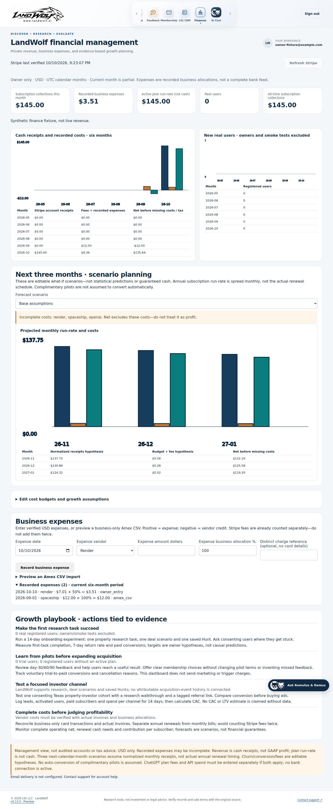
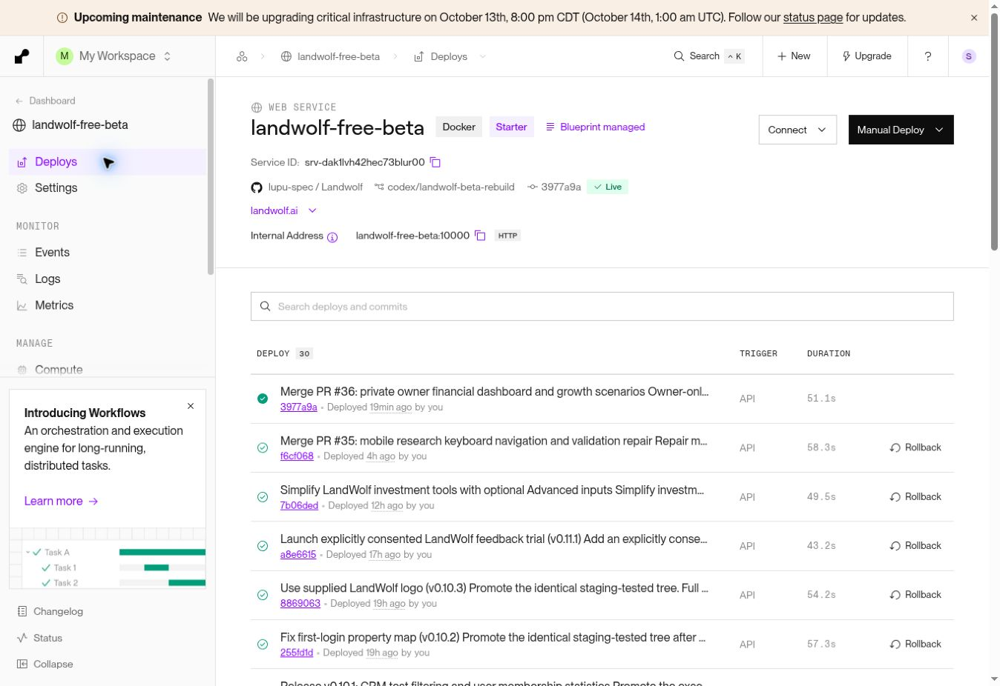

# Private owner financial management — v0.13.0

Status: v0.13.0 live in staging and production; PR #36 merged. All six focused
production research journeys passed after explicit owner approval of a one-hour
disposable test grant. The grant was revoked and its sessions invalidated.
[PR #36](https://github.com/lupu-spec/Landwolf/pull/36) contains the verified code.
The owner approved the existing internal Render verification workflow on October 10.
External database networking and credentials were not changed.

## Usage

Sign in as the configured owner and choose **Finances** in the dock. Other accounts
cannot see the navigation option and receive server-side 403 for the routes.
Anonymous requests receive 401. Private API responses are not cached.

**Refresh Stripe** reads the existing live account using GET-only calls. It never
charges, cancels, changes prices or modifies customers. All available history is
paginated with limits; an incomplete read fails visibly and retains the last complete
snapshot. The dashboard shows six UTC calendar months, all-time subscription
paid-invoice collections, account receipts/refunds/fees, and active list-price
monthly/annual run-rate. These are separate measures; payouts are not sales.
Taxes, discounts, payment timing and excluded non-USD/unsupported records prevent
this management view from being audited accounting or a profit claim.

Record actual USD business expenses for Render, Spaceship, OpenAI/ChatGPT, or Other.
Positive amounts are debits; negative amounts are credits. Allocate only the business
percentage, and never duplicate Stripe fees. Identical same-day vendor/amount/reference
entries are flagged; a distinct non-sensitive reference permits genuine separate charges.
There is no deletion of existing financial history. Correct an erroneous amount with
an explicit offset entry and reference, preserving the audit trail.

Amex CSV import requires `Date,Description,Amount` headers, ISO or MM/DD/YYYY dates,
positive USD debits and negative credits, at most 100 KB and 500 rows. Preview selects
only recognized Render, Spaceship and OpenAI/ChatGPT descriptions. Review every vendor
match and allocation before confirming. Card numbers, bank credentials, complete
descriptions and unrelated personal transactions are not saved. Prefer exporting
only business rows. There is no active live Amex/bank connector; none was confirmed.
Amounts containing commas must be quoted and properly grouped. Extra/duplicate
columns or ambiguous grouping fail atomically rather than changing a charge amount.

Enter verified monthly/annual budgets and annual renewal dates. ChatGPT membership
and OpenAI API usage are separate costs. No amount is inferred from the user's plan.
Blank required vendor budgets remain unknown, and net excludes missing costs.

## Forecasts and growth actions

The next three calendar months use editable new-user, voluntary conversion, churn,
new monthly price and processing-fee hypotheses. Conservative/base/growth scenarios
vary acquisition and churn; they are not statistical predictions. Annual vendor
costs appear in their renewal month; subscription revenue uses normalized run-rate,
not exact annual renewal cash timing. Complimentary users are never assumed to
convert automatically. Graphs include zero, negatives and exact accessible tables.

The growth playbook ties recommendations to aggregate real-user/membership counts,
excluding owners and smoke tests. It proposes a measured 14-day onboarding funnel,
voluntary pilot feedback/conversion, focused acquisition cohort and cost reconciliation.
CAC, LTV, causal uplift and channel attribution are not invented without event data.
No marketing is sent and no trial policy or billing consent is changed.

## Preservation and verification

Schema 13 only adds `lw2_finance_expenses`, `lw2_finance_settings`,
`lw2_finance_snapshots` and `lw2_finance_audit`. Existing tables, identities,
billing, CRM and trial information must remain intact. Forecast settings use
optimistic revisions; failed submissions preserve form values. CSV changes invalidate
the preview, preventing stale confirmations. Logout removes financial DOM content.

Local checks: 20 frontend tests, 571 full backend tests after final CSV
hardening, and 35 focused finance tests;
format/lint/types, browser build, source/wheel/package, Bandit, dependency audits,
secretlint and diff check passed. Browser launch failed because executables are
unavailable; that is not a browser pass. Disposable PostgreSQL/restore and legacy
tests passed in hosted CI. New tests cover owner/anonymous/nonowner boundaries, CSRF,
strict money/allocation validation, future-date rejection, import atomicity/privacy,
credits/duplicate protection, stale-plan conflict, failed refresh preservation,
GET-only Stripe reconciliation, annual normalization and forecast year rollover.

Six browser cases exercise Chromium/WebKit at 390/834/1440 px, synthetic revenue,
accessible charts, mobile input sizing, failure/retry values, CSV preview/confirmation,
duplicate recovery and logout cleanup. Their screenshots contain synthetic fixture
aggregates only, never live owner's finances. Both retained screenshots were visually reviewed.

[Phone dashboard, synthetic test figures](images/owner-finance/finance-synthetic-webkit-390.png)

The initial candidate `0ddc3b6820aa4d1d963777533aed370e08098d06` passed hosted
all hosted format/lint/types, frontend/backend, PostgreSQL/restore, browser,
build/package/security and diff gates. Hosted legacy run `38086909782`
passed 53 tests, and static release preflight passed in `38086909795`; conditional
production/staging preflight jobs were skipped, not passes.

Final CSV-hardened code `69872762ddd7690f44663e326e0c7238def18f38`, tree
`7e2b79129a66dc7fce4796bf1a4f730e8e104e4e`, passed the entire hosted gate suite
in [run 38087331017](https://github.com/lupu-spec/Landwolf/actions/runs/38087331017):
571 backend, 20 frontend, 114 unique browser tests (including six finance cases),
disposable PostgreSQL, exact 36-table dump/restore, builds/package, security and diff.
The additional focused browser invocation passed 18 existing keyboard/dock/assistant
cases; those are a subset of the full suite, not additional unique coverage.
Legacy [run 38087330980](https://github.com/lupu-spec/Landwolf/actions/runs/38087330980)
passed 53 tests; static preflight passed in `38087330970` with conditional deployment
preflight jobs skipped. Screenshots came from the first fully passing candidate,
whose UI is byte-identical to the CSV-hardened code; they are not live owner records.
The original artifact ZIP SHA-256 was
`ca9b0a38b4ebe3dc048f0e2914b38c10f07bcd24d4f921a633c57088c40b8ca4`.

At the initial October 10 release hold, staging remained v0.12.2 deployment
`dep-db59puflot8c73e70rq0`, runtime `deafae9734a589718bf99912cdfab94164bdafa0`;
production remained v0.12.2 deployment `dep-db59v7lckfvc739fkme0`, runtime
`f6cf068809bbc18ec9c8919156967a003e280b93`. Neither branch/service/database,
existing account, customer billing, CRM or trial record was changed by this work.
At that inspection, new staging/production acceptance and promotion were **Not run**.
Do not open database networking or extract credentials to bypass the external
query blocker. An approved existing internal verification workflow is required
before releasing the additive migration. The subsequent owner approval enabled the
authenticated service-console preservation checks recorded below.

## October 11 deployment and hosted acceptance

Staging Render `dep-db5d57vlot8c73ehshd0` became live at
2026-10-11 00:05:56 UTC, runtime `3a755fd3e1c65a82e1836c67d1cabca12a49f2f3`,
v0.13.0. Its complete source tree is `517917a8cb89a126395fc58d101cd11351109598`.
The same final commit passed beta gates `38088229697`, legacy `38088229668`, and
static preflight `38088229658`; conditional environment preflight jobs were skipped.
Standard exact staging acceptance `38097194179` passed at 00:07:44 UTC:
HTTPS, immutable identity, healthy database, expected billing/email modes, four
Chromium/WebKit phone/desktop journeys, financial/private-route boundaries, both
persistent-cookie/cache-clear/browser-restart/logout journeys. A normal staging
sign-in also correctly withheld Finances from the nonowner account.

The initial focused staging run `38097334110` passed five research journeys and
failed before the sixth reached the workspace. The failure was at sign-in, before
research edits. The acceptance-only branch now isolates each run's retained smoke
account and records HTTP authentication status without recording credentials or
response bodies. No runtime gate, authentication limit or customer data was changed.
The rerun `38097604721` passed all six Chromium/WebKit 390/834/1440px journeys
at 00:14:04 UTC. Each tested both editors, Done, viewport geometry, native
validation/mode switching, emulated 503 failures, successful real-backend retries,
preserved values, navigation, owner-route denial and logout. The retained phone and
tablet screenshots were visually reviewed. The ZIP SHA-256 is
`9b90f76d22bb5a13a494b95dd518d18c7217762b606b171b4b556b2ae010558e`.
The first failure coincided with overlapping hosted sign-ins near the end of a
12-per-10-minute authentication bucket; rate limiting is an inference, since that
first tool did not retain the response status. The complete independent rerun is
the staging release evidence, not a combination of partial passes.

An authenticated production service console captured a read-only, repeatable-read
baseline across 30 nonvolatile pre-existing tables. Accounts, CRM contacts and
activities use `created_at <= 1791677000` (2026-10-11 00:03:20 UTC), excluding
subsequent smoke registrations. Baseline counts include 41 accounts, 42 contacts,
32 activities, two billing customers, one project and one access reservation.
Sessions and rate buckets are intentionally excluded; schema 12 must become 13.
Production owner existence and current live Stripe configuration were verified
without exposing keys, credentials, customer bodies or financial amounts.

Production Render `dep-db5dapdckfvc739qeaig` became live at
2026-10-11 00:17:28 UTC, v0.13.0, runtime merge
`3977a9aeced1dde09fb6d165726535b4ebc5aab1`. Its entire tree exactly equals the
staging-tested tree. Existing service/database IDs, billing/email configuration,
origins and external database restrictions were retained. Schema 13 and all four
new finance tables were observed through the authenticated service console.

Standard exact production acceptance `38097869092` passed at 00:18:23 UTC:
HTTPS/immutable identity, health, live billing/email modes, anonymous financial 401,
nonowner financial 403 and hidden navigation, four Chromium/WebKit phone/desktop
login/paywall/logout journeys, and both persistent-session/cache/restart/logout checks.
Staging's complete repeated beta gates also passed in `38097194189`: 571 backend,
20 frontend, 114 unique browser, disposable PostgreSQL/exact 36-table restoration,
build/package/security and diff. The final merge's additional CI replay is separate
from the identical staged tree's already-completed release gates.

Post-deployment read-only comparison matched all 25 nonvolatile customer tables,
including pre-existing accounts, billing customers/events/exemptions, CRM, trial,
feedback, research and Hunt records. The schema-version change was expected.
Four public-source operational tables changed during ordinary catalog refresh;
eight new source runs and the existing 40-runs-per-source retention were confirmed
in live metadata and unchanged `trust.log_run` code. Source history therefore is
not claimed byte-identical. No migration reset, restore or customer deletion ran.

The deployed `finance.report` generated six historical months, nine scenario rows
for November/December 2026 and January 2027, and the growth playbook. Its actual
`stripe_snapshot` completed the existing live-account GET-only reads and validated
the configured account; no financial amounts or response bodies were published.
No expense, plan, cached Stripe snapshot or billing write was performed by these
checks. Live production/staging app.js and styles.css matched byte-for-byte.

Focused production acceptance `38097925640`, attempt 2 / job `114349928546`,
**Passed** all six journeys at 2026-10-11 00:33:25 UTC against immutable production
`3977a9aeced1dde09fb6d165726535b4ebc5aab1`: Chromium/WebKit at 390/834/1440 px,
both research views, Done and emulated keyboard geometry, address/coordinate native
validation, injected 503 and real-backend retry with retained values, navigation,
privacy and logout. Screenshot artifact `11686327884` has SHA-256
`9ae4d284ad9c1c078843eb3826f006aeef5bd9a58c6a1f0f058c52753e52ad6a`;
phone decision and tablet property screenshots were downloaded and visually reviewed.

**Failed, resolved:** attempt 1 timed out at 00:28:27 UTC waiting for entitlement.
Automatic approval review had rejected the temporary grant as not specifically
authorized, and no write executed. The owner then explicitly approved up to one
hour for one disposable production account, followed by revoke/session cleanup.
Attempt 2 created a fresh ordinary account; audited access was granted at
00:32:31 UTC and revoked at 00:34:25 UTC, under two minutes later. No owner role,
Stripe customer or charge was created. Cleanup verified zero active grants, zero
sessions and zero Stripe customers for that account. Account, research and grant/
revocation audit records remain retained. Afterward, all 25 original customer-table
counts and SHA-256 digests still matched the pre-deployment baseline, excluding
new disposable account/CRM/research/audit additions using the recorded cutoff.
The final runtime merge's complete gate replay `38097871759` also **Passed**,
including 571 backend, 20 frontend, 114 browser and exact 36-table restoration.
Ledger HTTPS/logo smoke `38098392044` **Passed** after the stale rows were corrected.
Physical OS keyboard testing remains **Not run**.

The cloud browser could open staging but displayed Site Unavailable for landwolf.ai
after one reload, so an interactive production owner sign-in was **Not run**.
This does not establish an outage: exact production HTTPS/browser CI and the
service-console HTTP/finance checks passed. The ledger-image smoke run
`38097869102` initially failed because RELEASES.md still described v0.12.2; the
deployment-note update corrects both observed runtime rows without changing code.
The post-deploy error scan found one upstream `ar_cosl` HTTP 500 at 00:17:50 UTC.
The existing source-refresh failure policy retains cached verified inventory and
shows the freshness warning. This upstream availability failure was not repaired
or treated as a finance/session test failure; no parser/URL change was justified.

| Hosted / internal verification | Result |
| --- | --- |
| `scripts/check_hosted_staging.py --environment staging --commit 3a755fd3e1c65a82e1836c67d1cabca12a49f2f3` | Passed, `38097194179` |
| `scripts/check_hosted_mobile_research.py --environment staging --commit 3a755fd3e1c65a82e1836c67d1cabca12a49f2f3` | Passed, six, `38097604721`; initial run failed at sign-in |
| `scripts/check_hosted_staging.py --environment production --commit 3977a9aeced1dde09fb6d165726535b4ebc5aab1` | Passed, `38097869092` |
| Production read-only row-count/SHA-256 comparison; `finance.report`; GET-only `finance.stripe_snapshot`; exact identity and live asset comparison | Passed, authenticated Render service console |
| `scripts/check_hosted_mobile_research.py --environment production --commit 3977a9aeced1dde09fb6d165726535b4ebc5aab1` | Passed, six, `38097925640` attempt 2; approved test grant revoked and sessions invalidated |
| Acceptance-only tool Ruff format/lint, `py_compile`, Bandit | Passed, local and hosted |

Safety bounds: 100 KB/500-row CSV imports, up to 1,000 records per Stripe resource
per complete refresh, and up to 500 expenses in the current six-month report.
Overflow fails visibly, never silently truncates financial totals or replaces the
last complete Stripe snapshot. Higher-volume reporting needs an approved extension.

## Exact local commands

From `beta/`, unless noted. Successful chained commands preserve failure exit status.

| Commands | Result |
| --- | --- |
| `.venv/bin/ruff format --check landwolf tests scripts`; `npm run format:check` | Passed |
| `.venv/bin/ruff check landwolf tests scripts`; `npm run lint` | Passed |
| `.venv/bin/mypy landwolf`; `npm run typecheck` | Passed |
| `npm run test:unit` | Passed, 20 |
| `.venv/bin/pytest -q -m 'not browser' --tb=short` | Passed, 571 after final CSV hardening |
| `.venv/bin/pytest -q tests/test_finance.py --tb=short` | Passed, 35 after CSV hardening |
| `npm run build` | Passed |
| `.venv/bin/python -m build`; `.venv/bin/python scripts/check_package.py` | Passed |
| `.venv/bin/bandit -q -r landwolf`; `.venv/bin/pip-audit --local --skip-editable` | Passed |
| `npm audit --audit-level=moderate`; `npm run secrets` | Passed |
| `uv lock --check`; `git diff --check` | Passed |
| `.venv/bin/pytest -q -m browser tests/test_finance_browser.py --tb=short` | Failed launch: six cases, browser executables missing |
| `.venv/bin/python scripts/check_postgres.py`; `.venv/bin/python scripts/check_restore.py` | Not run successfully locally: disposable CI service required |
| Legacy `PYTHONPATH=. pytest -q` | Not run locally; 53 passed hosted |
