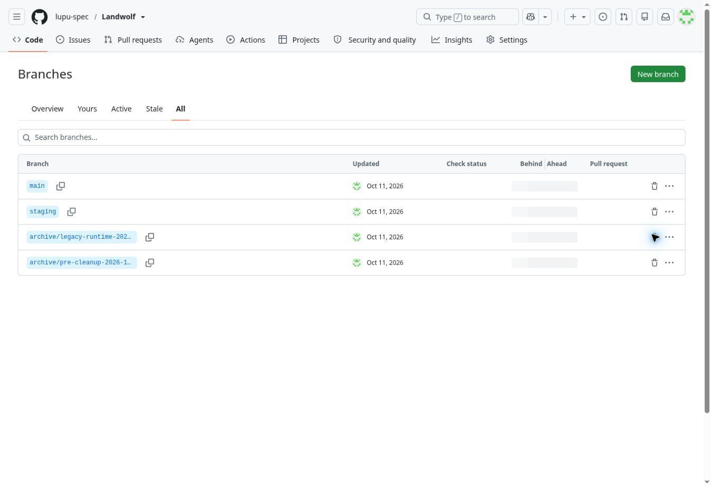

# Repository cleanup — October 11, 2026

Status: repository organization, Render source connections and hosted release
verification complete. Production was not redeployed. Existing
customer accounts, billing, CRM, database identifiers, domains and secrets were
not edited by this maintenance. Hosted login checks use their own new disposable,
non-entitled verification accounts; they never charge or contact customers.

The production Render service was renamed in place to `landwolf-production`.
Its ID, assigned URL, custom domains and live deployment are retained. The production
Blueprint has automatic synchronization paused. The retired original Render service
had automatic deployment from `main` enabled; that was disabled before changing
`main`, and its source was pinned to the original legacy snapshot.

The current project moves from its historical directory to `app/`, retaining
identical Python runtime modules, browser source/assets, Dockerfile, dependency
versions, database schema and runtime version. Package names are `landwolf` and
`landwolf-ui`; the package verifier follows the new distribution name. Docker build
settings, current workflows and documentation use the new path. Legacy application,
configuration and unsafe-to-reuse live verification workflows are archived under
`archive/legacy/`, with all 53 legacy regressions retained in a separate CI job.

The current supported branches are `main` and `staging`. Two dated archive branches
retain all 38 original tips plus the old Render service's buildable legacy tree.
The recovery commit's 36 distinct parents were independently read back from GitHub
and matched every original tip. Existing open PRs are superseded or archived without
merging unreviewed work. The complete branch/SHA index is `archive/BRANCHES.json`.
GitHub's final inventory has four branches and zero open PRs. Thirty-seven original
non-default branch names were retired after preservation; the temporary cleanup
branch was also retired after its commits became reachable from `main` and `staging`.
The original `main` history was retained by a fast-forward, not a forced rewrite.

| Connection | Current source | Retained running commit / deployment |
| --- | --- | --- |
| Production `srv-dak1lvh42hec73blur00` | `main`, `app/Dockerfile`, context `./app` | `3977a9aeced1dde09fb6d165726535b4ebc5aab1` / `dep-db5dapdckfvc739qeaig` |
| Staging `srv-dantt23tqb8s73d55dfg` | `staging`, `app/Dockerfile`, context `./app` | `3a755fd3e1c65a82e1836c67d1cabca12a49f2f3` / `dep-db5d57vlot8c73ehshd0` |
| Retired original `srv-daj2ldfqj5pc73c1aidg` | `archive/legacy-runtime-2026-10-11`, original commands | `5307de0a11fd75a7c51bdf5243f3e13179b95d38` / `dep-dajdc1uk1f9s73d6uu40` |

All three services have automatic deployment off. Production Blueprint
`exs-dak1e78ae00c73eneogg` uses `main` / `render.yaml`; staging Blueprint
`exs-dantsjegekts73a5njc0` uses `staging` / `render.staging.yaml`. Both have automatic
synchronization paused. Filename changes generated pending Blueprint proposals;
neither proposal was approved or applied. The consolidated staging Blueprint
preserves its actual paid PostgreSQL plan `0.1c-256mb`, 1 GB storage, PostgreSQL 18
and disabled storage autoscaling. No replacement database or service was created.
Production's existing Starter service and `basic_256mb` database remain intact.

Existing database identifiers, platform-assigned hostnames and the local-development
SQLite filename retain their historical spelling as compatibility identifiers. They
are not product names or a release status. Renaming live connection identifiers or
DNS targets is outside this maintenance; no storage is recreated and no customer
record is changed. Historical deployment evidence remains dated and append-only.

## Verification

Commands below ran from `app/` unless a different directory is stated. **Passed**
means exit 0. The repository restructuring changes no runtime behavior: a Git blob
comparison against `9bfdcd1ddba1ba884b53cf8f9577f8cc6227feb8` confirmed all 70
Python runtime, browser source/assets and Dockerfile contents remained identical.

| Command | Result |
| --- | --- |
| `uv sync --frozen --dev` | Passed |
| `uv sync --frozen --dev --reinstall` | Passed; repaired relocated executable paths using the same locked versions |
| `uv lock --check` | Passed |
| `npm ci` | Passed |
| `.venv/bin/ruff format --check landwolf tests scripts` | Passed |
| `npm run format:check` | Passed |
| `.venv/bin/ruff check landwolf tests scripts` | Passed |
| `npm run lint` | Passed |
| `.venv/bin/mypy landwolf` | Passed; 38 modules |
| `npm run typecheck` | Passed |
| `npm run test:unit` | Passed; 20 tests |
| `.venv/bin/pytest -q tests/test_version.py` | Passed; 7 tests after correcting the distribution-name assertion |
| `.venv/bin/pytest -q -m 'not browser'` | Passed; 571 tests, 114 browser cases deselected for this separate unit command |
| `npm run build` | Passed |
| `.venv/bin/python -m build` | Passed; wheel and source distribution |
| `.venv/bin/python scripts/check_package.py` | Passed |
| `.venv/bin/bandit -r landwolf` | Passed; zero findings |
| `.venv/bin/pip-audit --local --skip-editable` | Passed; no known vulnerabilities |
| `npm audit --audit-level=moderate` | Passed; zero vulnerabilities |
| `npm run secrets` | Passed |
| `git diff --check` and `git diff --cached --check` (root) | Passed |

### Resolved failures and local limitations

- The first relocated mypy executable referenced the former directory (exit 127).
  Reinstalling the frozen environment repaired its shebang; the type check passed.
- The first non-browser suite failed one assertion because the lockfile distribution
  name had changed to `landwolf`. The assertion was corrected to the new name;
  no version, dependency, test coverage or gate was weakened. The full rerun passed.
- The first archived legacy CI run (`38144441401`) had 52 passes and one failure
  because the original README was missing. Its exact original blob was restored
  under `archive/legacy/README.md`; run `38144678410` passed all 53 unchanged tests.
- Local `.venv/bin/pytest -q -m browser` was interrupted (exit 130) after missing
  browser executables caused failures. The diagnostic command
  `.venv/bin/pytest -q -m browser tests/test_finance_browser.py -x` failed (exit 1)
  because Chromium was not installed. These local runs are **Failed**, not passes;
  the hosted CI environment installs Chromium and WebKit and runs the full suite.
- Local legacy `PYTHONPATH=. python3 -m pytest -q` could not run (exit 1: missing
  pytest); an attempted root `.venv/bin/python -m pytest -q` exited 127 because that
  environment does not exist. Legacy validation is **Passed in hosted CI**, using
  its own requirements environment and the exact `PYTHONPATH=. pytest -q` command.
- Disposable PostgreSQL integration and restore checks run in CI, not against any
  customer database. Physical OS keyboards were **Not run** for this maintenance.

### Hosted evidence

Application run `38144678406` passed on cleanup candidate
`b0cf8f3f97018e87a9a63b651d09199f7d080e11`: 571 backend, 20 frontend, 18 focused
browser checks and the full 114-browser suite; disposable PostgreSQL integration;
exact backup/restore digests across 36 tables; build/package, formatting, lint,
types, dependency/static security and diff gates. Legacy run `38144678410` passed
53 tests. The later canonical configuration commit changes only workflow branch/
ledger triggers and the staging Blueprint's plan metadata, not application code.

Production hosted runs `38145485299` and `38145772495` passed exact deployed identity,
HTTPS, billing/email modes, private-route boundaries, Chromium and WebKit at 390px
and 1440px, cache clearing, persistent browser restart, logout and owner-only access.
Staging run `38145773380` passed the same four Chromium/WebKit mobile/desktop
journeys and both persistent-session restart/logout checks, plus live mapped
inventory, successful research response, CSRF rejection, handoff and owner access
boundaries. Both hosted commands used the actual retained deployment commits.
Read-only live smoke run `38145485290`, attempt 3, passed both environments' exact
version/commit/health and logo/fallback-image hashes, plus the `www` HTTPS endpoint.
Attempts 1 and 2 failed on staging read timeouts; production passed in both.

Staging displayed Render's free-instance loading page, and recent application logs
were empty. The existing staging build was restarted through Render's **Restart
service**, not a deploy action. The event was confirmed and logs showed schema 13
ready, preserved accounts/sessions and successful server startup. Its commit and
deployment ID remain unchanged. No runtime version was reused for changed code.

The root live-check ledger keeps actual running commits separate from cleaned
source branch heads. Hosted checks now read the expected immutable deployment from
that ledger and rerun when the ledger changes. No gate was removed or weakened.

